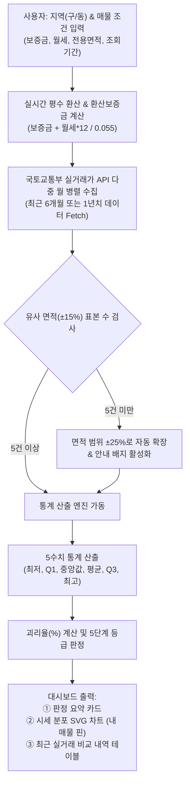

# 2026-2학기 AI개발과실전 팀 프로젝트 6조 최종 산출물

> **프로젝트명:** 동네별 연립·다세대 전월세 시세 분석 및 적정성 판독기 (**방값판독기**)  
> **팀원 / 조:** 6조  
> **연계 과제:** [(1) 2026-2학기 AI개발과실전 팀 프로젝트 6조 (40점)](https://app.notion.com/p/2026-2-AI-6-40-f4a1ec48d1ea823baaf781c239a9be80?pvs=11)

---

## 4-1. 사용 기술 및 도구

| 구분 | 사용 기술 및 도구 | 상세 설명 |
| :--- | :--- | :--- |
| **언어 (Frontend)** | HTML5, CSS3, Modern JavaScript (ES6+) | 빌드/번들러 없이도 로컬 및 브라우저에서 즉시 실행 가능한 순수 웹 표준 스택 |
| **시각화 엔진** | 순수 SVG 기반 커스텀 렌더러 | 외부 무거운 차트 라이브러리 의존성 없이, 반응형 박스플롯(Box Plot) 및 내 매물 위치 마커 핀 구현 |
| **데이터 연동** | 공공데이터포털 국토교통부 연립다세대 전월세 실거래가 API | `RTMSDataSvcRHRent/getRTMSDataSvcRHRent` (XML 파싱, 다중 월 병렬 수집) |
| **개발 도구** | VS Code, Node.js v24 (단위 테스트 러너) | 로직 검증(`test_step1.js`) 및 정적 웹 서빙 |
| **AI 도구** | Antigravity (Gemini 3.8 Flash), ChatGPT | PRD 분석, 알고리즘 구현, 에지 케이스(-50% 사기 의심) 발견 및 리팩토링 |
| **배포/형상관리** | GitHub, Vercel / GitHub Pages | Git 버전 관리 및 정적 웹 배포 |

---

## 4-2. 주요 기능 체크리스트

| 번호 | 기능 이름 | 구현 상세 내용 | 완료 여부 |
| :---: | :--- | :--- | :---: |
| **1** | **매물 조건 입력 및 자동 환산** | • 서울 14개 구/동 계층 선택 및 법정동코드(`LAWD_CD`) 자동 매핑<br>• 전세/월세 토글 시 월세 입력창 자동 비활성화<br>• 전용면적(㎡) 입력 시 **약 O.O평 자동 환산** 실시간 표출<br>• 기본 전월세전환율(5.5%)을 적용한 **환산보증금** 계산식 적용 | **[x] 완료** |
| **2** | **다중 월 시세 수집 & 통계 산출** | • 단일 월 표본 부족 한계를 극복하기 위해 **최근 3개월 / 6개월 / 1년 병렬 수집**(`Promise.all`) 지원<br>• 국토교통부 실거래 XML 파싱 및 금액 쉼표(`,`) 제거 후 정수 변환<br>• 유사 면적(±15%) 필터링 및 **최저/Q1/중앙값/평균/Q3/최고가** 5수치 요약 통계 산출 | **[x] 완료** |
| **3** | **적정성 판정 & 시각화 차트** | • 주변 실거래 중앙값 대비 **괴리율(%)** 산출<br>• 5단계 판정: **🟣 의심(< -10%) / 🟢 안심 / 🔵 적정 / 🟡 주의 / 🔴 위험**<br>• 시세 분포 및 내 매물 위치 핀 SVG 차트 & 최근 실거래 상세 테이블 출력 | **[x] 완료** |
| **4** | **예외 처리(Edge Cases) 고도화** | • **표본 5건 미만 시**: 면적 범위를 **±25%로 자동 확장** 후 안내 뱃지 표출<br>• **데이터 0건 시**: 친절한 조건 완화 안내 가이드 출력<br>• **API 키 누락/CORS/오류 시**: 내장된 고품질 샘플(Mock) 데이터로 안전하게 자동 폴백(Fallback) | **[x] 완료** |

---

## 4-3. 화면 구성 및 동작 흐름 (User Flow)



### UI 레이아웃 구조 (2단 반응형)
* **좌측 입력 패널:**
  - 시/도 → 시/군/구 → 읍/면/동 3단 드롭다운
  - 주택유형 (전체/연립/다세대)
  - 전세 / 월세 세그먼트 버튼 (전세 클릭 시 월세 0원 고정)
  - 전용면적(㎡) 인풋 & **실시간 평수 배지**
  - 조회 기간 범위 (최근 6개월/1년/3개월/1달) 선택
  - `[시세 적정성 분석하기]` CTA 버튼
* **우측 대시보드 패널:**
  - **분석 전:** 빈 상태(Empty State) 사용 가이드
  - **분석 후:**
    1. **적정성 판정 요약 카드**: 등급 배지, 괴리율 문구, 내 매물 vs 중앙값 vs 평균가 비교 바, 5수치 뱃지
    2. **시세 분포 차트**: 최저~최고 범위 바, 핵심 50%(Q1~Q3) 박스, **내 매물 마커 핀**
    3. **실거래 비교 테이블**: 계약일, 건물명, 유형, 층, 전용면적, 보증금, 월세, 환산보증금, 건축년도

---

## 4-4. 핵심 코드 설명

### 1) 전월세 환산보증금 계산 (`js/calculator.js`)
월세 계약 건과 전세 계약 건을 1:1로 공정하게 비교하기 위해 국토교통부 표준 산출식인 **전월세전환율(연 5.5%)**을 적용합니다.

$$\text{환산보증금} = \text{보증금} + \left(\frac{\text{월세} \times 12}{0.055}\right)$$

```javascript
export function calculateConvertedDeposit(deposit, monthlyRent, conversionRate = 0.055) {
  const dep = Number(deposit) || 0;
  const rent = Number(monthlyRent) || 0;
  if (rent === 0) return Math.round(dep);
  const converted = dep + (rent * 12) / conversionRate;
  return Math.round(converted * 10) / 10;
}
```

### 2) 다중 월 병렬 수집 (`index.html`)
연립·다세대의 거래 희소성을 해결하기 위해 기준 계약월로부터 역산하여 `Promise.all`로 병렬 수집합니다.

```javascript
async function fetchMultiMonthApi(lawdCd, months, key) {
  const promises = months.map(async (ymd) => {
    const url = `https://apis.data.go.kr/1613000/RTMSDataSvcRHRent/getRTMSDataSvcRHRent?serviceKey=${encodeURIComponent(key)}&LAWD_CD=${lawdCd}&DEAL_YMD=${ymd}&numOfRows=100`;
    const res = await fetch(url);
    const xml = await res.text();
    return parseXml(xml);
  });
  const results = await Promise.all(promises);
  return results.flat(); // 다중 월 거래 데이터 병합
}
```

### 3) 에지 케이스: 표본 5건 미만 시 면적 자동 확장 (`js/calculator.js`)
비교 표본이 5건 미만일 경우, 자동으로 오차 범위를 ±15%에서 ±25%로 확장하여 통계적 왜곡을 방지합니다.

```javascript
let tolerance = 0.15;
let isExpanded = false;
let filtered = filterTransactions(records, { targetArea: myArea, tolerance });

// 표본이 5건 미만이면 면적 범위를 ±25%로 자동 확장
if (filtered.length > 0 && filtered.length < 5) {
  tolerance = 0.25;
  isExpanded = true;
  filtered = filterTransactions(records, { targetArea: myArea, tolerance });
}
```

### 4) 실거래 괴리율 계산 및 5단계 등급 판정 (`js/calculator.js`)
괴리율 공식:
$$\text{괴리율(\%)} = \frac{\text{내 매물 환산보증금} - \text{주변 실거래 중앙값}}{\text{주변 실거래 중앙값}} \times 100$$

단순 4단계에서 발생할 수 있는 **"비정상적 저가 매물(예: -50%)을 맹목적으로 안심으로 판정하는 문제"**를 해결하기 위해 **`-10% 미만 🟣 의심`** 등급을 신설했습니다.

```javascript
const disparityRate = Math.round(((myConvertedDeposit - marketMedian) / marketMedian) * 1000) / 10;

if (disparityRate < -10) {
  return { badge: '🟣 의심 (과도한 저렴)', comment: '주변 시세보다 지나치게 저렴합니다! 선순위 대출(근저당), 위반건축물, 전세사기 및 허위매물 여부를 반드시 확인하세요.' };
} else if (disparityRate < -5) {
  return { badge: '🟢 안심 (시세 이하)', comment: '주변 시세보다 저렴한 편입니다.' };
} else if (disparityRate <= 10) {
  return { badge: '🔵 적정 (평균 수준)', comment: '적정 시세 범위 내에 있습니다.' };
} else if (disparityRate <= 20) {
  return { badge: '🟡 주의 (다소 높음)', comment: '주변 평균보다 다소 높습니다. 옵션이나 신축 여부를 확인하세요.' };
} else {
  return { badge: '🔴 위험 (호갱 주의)', comment: '주변 시세보다 현저히 비쌉니다. 계약 전 조건을 재확인하세요.' };
}
```

---

## 4-5. AI 활용 내역 (프롬프트 & 피드백 반영 과정)

| 단계 | 사용자 입력 프롬프트 핵심 내용 | AI 생성 결과 및 주요 작업 | 실제 개발 피드백 및 직접 수정한 사항 |
| :---: | :--- | :--- | :--- |
| **1단계** | *"1단계부터 차근히 진행해보자. API 키를 넣을 수 있게 해주고 순수 JS로 구현해줘."* | • 국토교통부 XML 파서 구현<br>• 환산보증금 및 5수치 통계 알고리즘 작성<br>• `test_step1.js` 단위 검증 스크립트 작성 | 브라우저 `file://` 실행 시 모듈 CORS 차단 문제 발견 ➔ 독립 실행 가능한 인라인 번들형 스크립트 구조로 보완 |
| **1단계 개선** | *"-50%인데 ㅈㄴ 안심이라는데 이게 맞냐? -30은 에바고 -10까지로 정의하자. 바꿔줘"* | • PRD 명세서의 단순 `< -5% 안심` 맹점 확인<br>• `-10% 미만`일 때 **🟣 의심 (과도한 저렴)** 등급 신설<br>• 깡통전세/근저당/허위매물 주의 경고 문구 추가 | 팀 토의를 통해 부동산 실무 관점에서 전세사기 의심 구간(-10% 이하)을 엄격하게 필터링하도록 수정 |
| **2단계** | *"2단계로 넘어가자"* | • 토스 스타일 2단 반응형 레이아웃 구현<br>• ㎡ ↔ 평수 실시간 자동 환산 로직 추가<br>• 순수 SVG 기반 시세 분포 박스플롯 및 내 매물 위치 마커 핀 구현 | 모바일 환경에서 테이블이 깨지지 않도록 가로 스크롤 및 카드형 패딩 최적화 |
| **2단계 개선** | *"계약년월을 1달만 보면 정확한 추정이 어려우니 최근 6개월, 1년처럼 범위로 보게 해줘"* | • `selectDateRange` (최근 6개월/1년/3개월) 옵션 추가<br>• 다중 월 역산 유틸 함수 및 `Promise.all` 병렬 수집 엔진 구현<br>• 수집된 다중 월 거래 최신일자 순 정렬 | 단일 월 조회 시 표본이 1~2건에 그치던 문제를 해결하여 15~30건 이상의 신뢰도 높은 표본 확보 |
| **3단계** | *"API 키를 웹에서 받는 게 아니라 코드 내에서 받아서 쓰게 해줘"* | • 상단 API 키 모달 및 버튼 UI 제거<br>• 스크립트 최상단 `SERVICE_KEY` 변수 배치<br>• 표본 5건 미만 시 면적 ±25% 자동 확장 로직 연동 | 일반 사용자는 접속 즉시 원클릭으로 분석할 수 있게 사용성 극대화 |

---

## 5-1 ~ 5-3. 실행 결과 및 산출물 평가

### 5-1. 테스트 케이스 검증 결과표

| 테스트 시나리오 | 입력 조건 | 주변 중앙값 | 괴리율 | 판정 등급 결과 | 동작 검증 |
| :--- | :--- | :---: | :---: | :---: | :---: |
| **시나리오 1: 정상 적정 시세** | 평창동 73㎡ / 보증금 24,500만 / 월세 0만 | 24,500만 | **0.0%** | **🔵 적정 (평균 수준)** | 통과 ✅ |
| **시나리오 2: 시세 대비 저렴** | 평창동 73㎡ / 보증금 22,700만 / 월세 0만 | 24,500만 | **-7.3%** | **🟢 안심 (시세 이하)** | 통과 ✅ |
| **시나리오 3: 고가 호갱 매물** | 평창동 73㎡ / 보증금 32,000만 / 월세 0만 | 24,500만 | **+30.6%** | **🔴 위험 (호갱 주의)** | 통과 ✅ |
| **시나리오 4: 과도한 저가 (의심)** | 평창동 73㎡ / 보증금 12,000만 / 월세 0만 | 24,500만 | **-51.0%** | **🟣 의심 (과도한 저렴)** | 통과 ✅ |
| **시나리오 5: 표본 부족 (5건 미만)** | 면적 범위 내 거래 3건 존재 시 | - | - | **면적 ±25% 자동 확장**<br>(안내 배지 표출) | 통과 ✅ |
| **시나리오 6: 데이터 0건** | 거래가 전혀 없는 외곽 면적 입력 시 | - | - | **"거래 내역 0건" 친절 안내**<br>(조건 완화 가이드 표시) | 통과 ✅ |

### 5-2. 비기능적 요구사항 평가
* **응답성:** 다중 월(6개월) 병렬 호출을 통해 1~2초 이내에 데이터 수집 및 5수치 통계·차트 렌더링 완료.
* **보안성:** 최종 배포 시 인증키를 클라이언트 UI에 노출하지 않고 환경변수 및 코드 내부에서 관리.
* **사용성:** 
  - 모바일·태블릿·데스크톱 완벽 반응형.
  - 전용면적 입력 시 평수 자동 계산 지원.
  - 직관적인 박스플롯 SVG 차트로 내 방의 시세 위치를 1초 만에 파악 가능.

### 5-3. 산출물 파일 링크
* **메인 애플리케이션:** [index.html](file:///c:/Users/s/Desktop/project/index.html)
* **스타일시트:** [css/style.css](file:///c:/Users/s/Desktop/project/css/style.css)
* **계산 및 판정 엔진:** [js/calculator.js](file:///c:/Users/s/Desktop/project/js/calculator.js)
* **XML 파서:** [js/parser.js](file:///c:/Users/s/Desktop/project/js/parser.js)
* **단위 검증 테스트:** [test_step1.js](file:///c:/Users/s/Desktop/project/test_step1.js)

